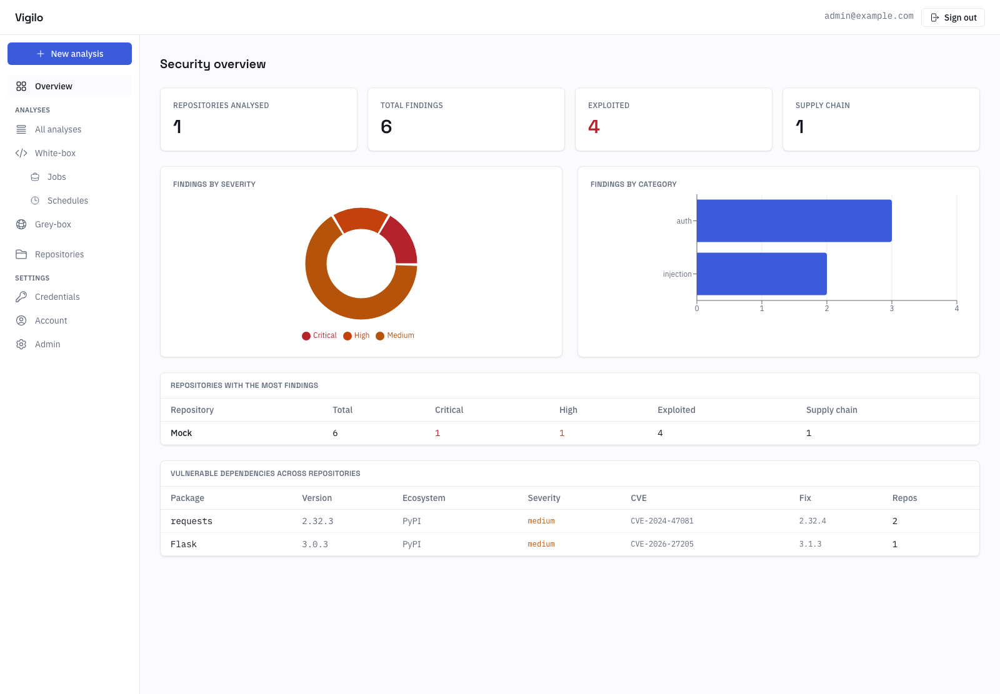
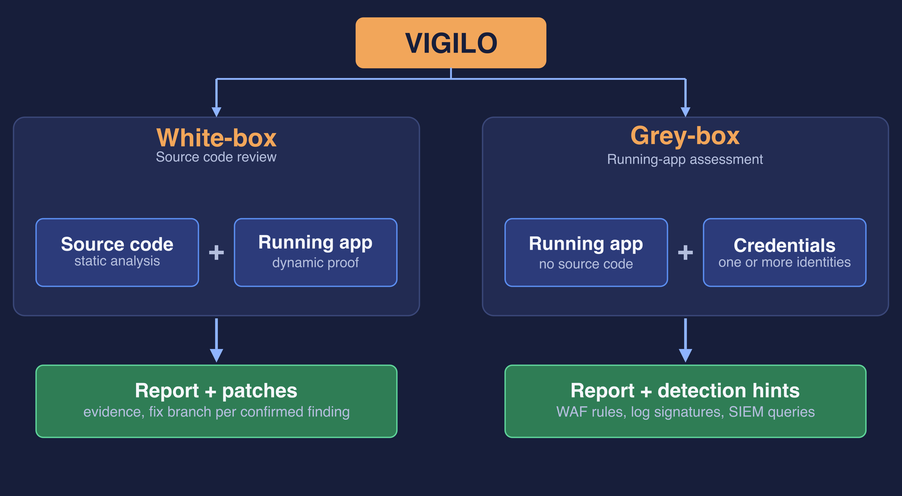
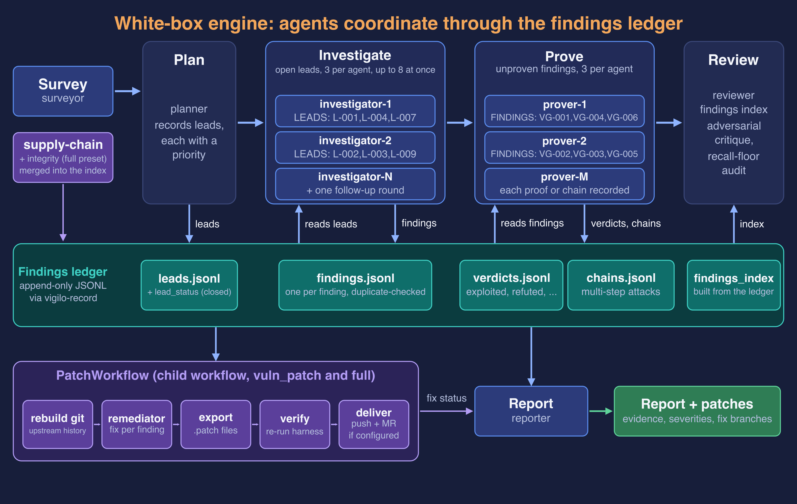
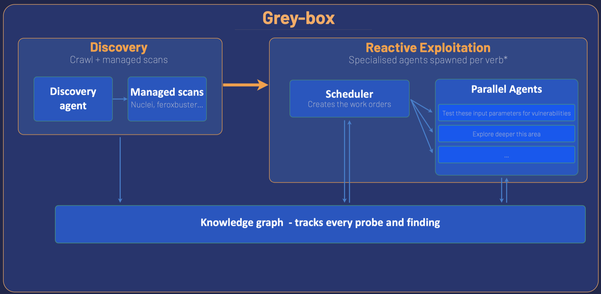
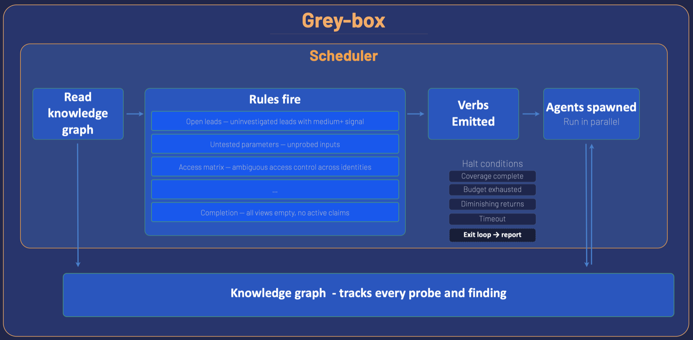
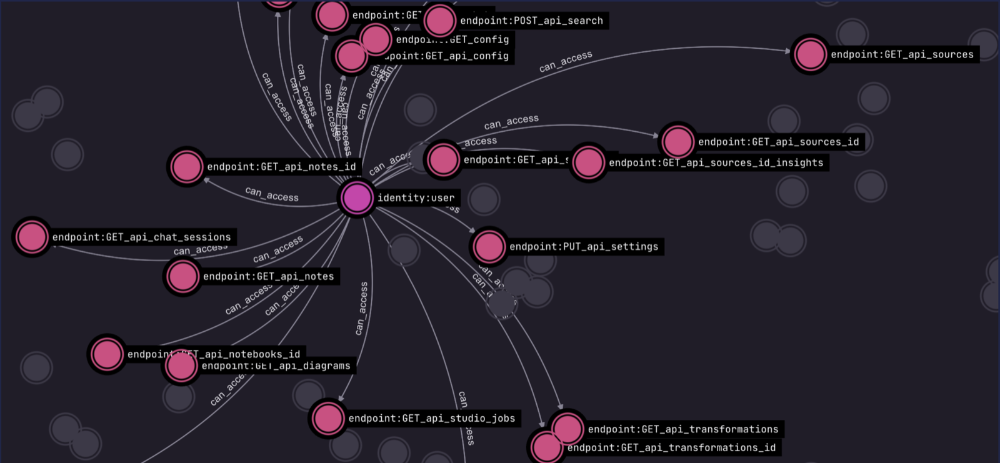
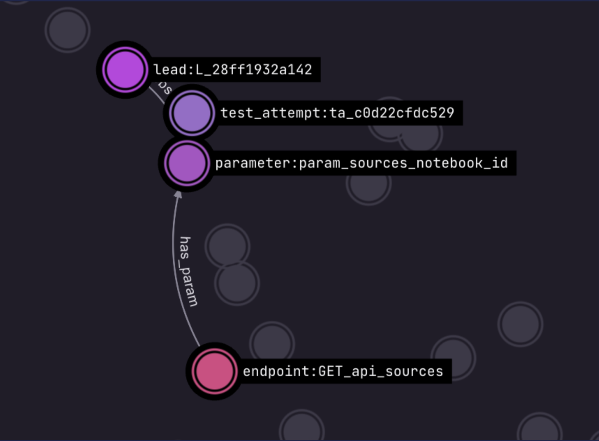
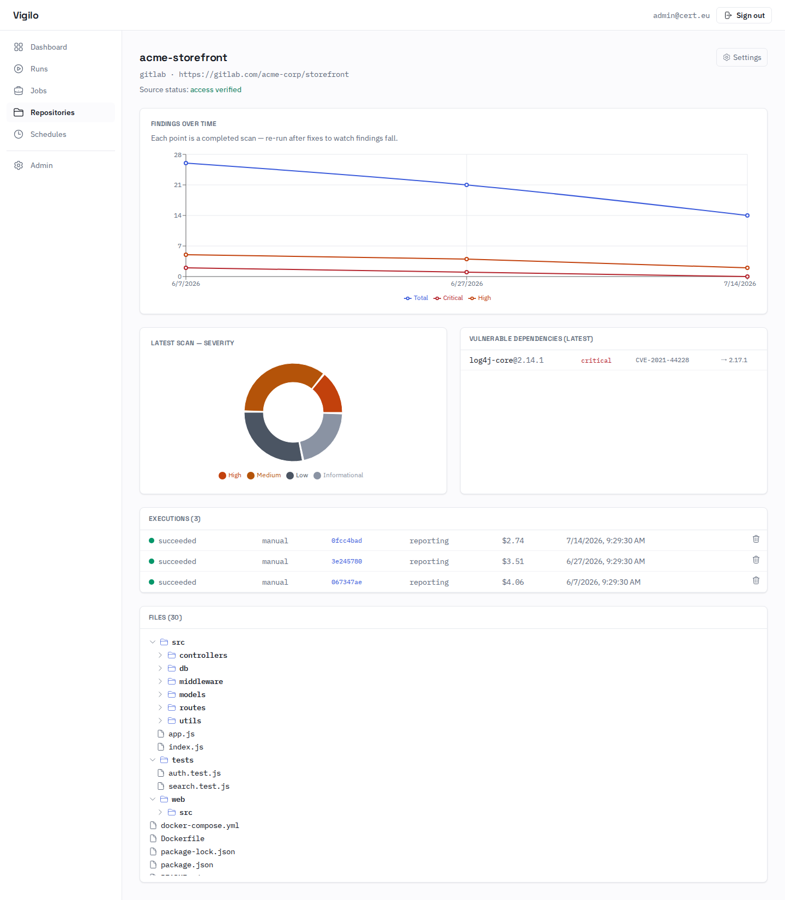

# Vigilo

**AI-powered penetration-testing pipeline.** Agents run a full vulnerability assessment of a
web application — from surveying the source through proving each finding to automated
remediation — and produce an evidence-backed report plus fix branches for every confirmed
finding.

Vigilo was built by **CERT-EU** so security teams can run repeatable, agent-driven pentests
against their own code and services. It ships two ways to run:

- **Web platform** — a multi-user API + web UI for white-box scans. Sign in, attach a
  repository (upload or GitLab), pick what to run, execute asynchronously, and browse findings,
  reports and dashboards.
- **Command-line grey-box** — test a running application without its source code, with `make`;
  no web platform required.

The pipeline combines orchestrated agents with an agentic coding CLI (Claude Code,
OpenAI Codex, or OpenCode), Playwright browser testing, and source-code analysis.

> **Licence:** [EUPL-1.2](#licence) · Copyright © 2026 European Union. See [`LICENSE`](LICENSE) and [`NOTICE`](NOTICE).

> [!WARNING]
> **Experimental software.** Vigilo is in alpha: it works end to end, but interfaces, defaults and
> outputs may change between versions, and its findings should always be reviewed by a person.
> It runs AI agents against code and applications you point it at — use it only on systems you
> are authorised to test, ideally with dedicated test accounts. Read [`SECURITY.md`](SECURITY.md)
> for the security model and its current limits. There is plenty of room for improvement; see
> [Next steps](#next-steps--contributions-welcome).



*The global dashboard — findings by severity and category, the most-affected repositories, and vulnerable dependencies aggregated across every scan.*

---

## Table of contents

- [What Vigilo does](#what-vigilo-does)
- [White-box and grey-box](#two-ways-to-test-white-box-and-grey-box) — [Which one do I want?](#which-one-do-i-want)
- [How the pipeline works](#how-the-pipeline-works) — [White-box](#white-box-pipeline) · [Findings ledger](#how-agents-coordinate-the-findings-ledger) · [Grey-box](#grey-box-pipeline) · [Output](#output)
- [Getting started (web platform)](#getting-started-web-platform)
- [Deployment options](#deployment-options)
- [Grey-box from the command line](#grey-box-from-the-command-line)
- [Pipeline modes](#pipeline-modes)
- [Model backend](#model-backend)
- [Access, credentials and GitLab push-back](#access-credentials-and-gitlab-push-back)
- [Configuration reference](#configuration-reference)
- [Security](#security)
- [Development](#development)
- [Next steps — contributions welcome](#next-steps--contributions-welcome)
- [Licence](#licence)

---

## What Vigilo does

You point Vigilo at a web application (and, in white-box mode, its source code). It then:

1. **Surveys** the target — maps the source, dependencies, and the live app.
2. **Plans** — turns the survey into a prioritised list of *leads*: places where a
   vulnerability might be.
3. **Investigates** the leads with parallel agents, which record confirmed findings in a shared ledger.
4. **Proves** the findings — parallel agents try to exploit each one, with captured evidence and
   screenshots, and record multi-step attack chains.
5. **Reviews** every finding adversarially — de-inflating overclaimed severities, collapsing
   duplicates, and moving low-value items to a hardening appendix. Nothing is silently dropped.
6. **Remediates** — generates a fix branch and patch per confirmed finding, verifies each fix,
   and can push them upstream and open one merge request per fix branch.
7. **Reports** — an executive summary with evidence, grouped findings, and (grey-box) blue-team
   detection hints.

In white-box mode these steps are run by a team of agents that never talk to each other directly:
they coordinate through a shared **findings ledger**, so many investigators and provers can work in
parallel without duplicating work. [How the pipeline works](#how-the-pipeline-works) explains the
engine, the ledger and the grey-box loop, with diagrams.

---

## Two ways to test: white-box and grey-box

The difference is simply **how much you give it**: with or without the source code. Everything
else — the agents, the exploitation, the adversarial critique, the report — follows from that.



*The two paths. **White-box** gets the source code *and* the running app, and returns a report plus working patches. **Grey-box** only gets the running app (plus credentials), and returns a report plus detection hints for your blue team.*

**White-box — source code review.** You give it a Git repository and (optionally, but strongly
recommended) a URL where the same application is running. Use it on **your own software**.
Vigilo reads the source to find where the bugs are, tries to trigger them against the live app to
prove they are real, and writes the fix: one branch and one patch per confirmed finding,
optionally pushed upstream as merge requests. *You get:* a report with evidence, plus fix
branches.

**Grey-box — penetration testing.** You give it a URL and, optionally, credentials. **No source
code.** Use it on **software you cannot see inside** — a vendor product, a SaaS, a black-box
service. Vigilo behaves like an external attacker who has been handed a login: it explores the
application, records what it learns in a knowledge graph, and lets a scheduler decide what to
probe next. It cannot propose patches, so it hands your defenders WAF rules, log signatures and
SIEM queries for every confirmed finding. (It is "grey-box" rather than "black-box" because you
normally give it valid credentials; testing only the logged-out surface misses most of an app.)
*You get:* a report with evidence, plus detection hints for your blue team.

### Which one do I want?

| Your situation | Mode | Why |
|----------------|------|-----|
| It's our code, in our Git | **White-box** | Deepest coverage, and you get patches you can merge. |
| It's a vendor product / SaaS we bought | **Grey-box** | You have no code to give it, and no way to patch it anyway. |
| We have the code, but can't deploy a running copy | **White-box** | Still works. Findings are confirmed at source level instead of over the network. |
| We have a running app but no code access | **Grey-box** | Exactly what it's built for. |
| We want to know what our SOC would actually see | **Grey-box** | Only grey-box produces detection hints. |

White-box runs on the [web platform](#getting-started-web-platform); grey-box runs
[from the command line](#grey-box-from-the-command-line).

---

## How the pipeline works

### White-box pipeline


*White-box at a glance: survey the code and the live app → plan leads → investigate them in parallel → prove each finding → adversarial review → patch → report. Purple stages depend on the preset.*

The orchestrator runs the stages below. Each stage is one agent or a batch of parallel agents,
and everything they learn goes into the findings ledger (next section):

```
Preflight      — validate target, credentials, environment
Survey         — surveyor: source, architecture and live-app map
                 (full preset: supply-chain and integrity agents then start in the
                 background and are collected before Review)
Plan           — planner records leads, each with a priority
Investigate    — investigator-1..N in parallel, each with its own LEADS: slice
Prove          — prover-1..M in parallel, each with its own FINDINGS: slice
Review         — reviewer: findings index, adversarial critique, recall-floor audit
Remediation    — PatchWorkflow child workflow (vuln_patch and full)
Report         — reporter: executive summary with evidence + screenshots
```



*The same engine in detail. Agents never talk to each other directly: the **findings ledger** sits at the centre. The planner writes leads, each investigator reads its slice of them and writes findings, each prover reads unproven findings and writes verdicts and chains, and the reviewer works from an index built from the ledger. `PatchWorkflow` and the reporter come after the review.*

- **Parallel by batches.** Open leads are split into batches of three (priority order), each to
  its own investigator, at most eight at once; one follow-up round covers leads still open.
  Unproven findings are batched the same way for the provers. One failing agent does not stop the
  others; a stage fails only when every agent in it fails. Leads still open at the end are listed
  in the report's Coverage section. The batching settings (`leads_per_investigator` = 3,
  `findings_per_prover` = 3, `investigation_followup_rounds` = 1, `max_concurrent_pipelines` = 8)
  are optional tuning fields when creating a job in the UI, or `pipeline_overrides` in the jobs
  API (`POST /jobs`, `PATCH /jobs/{id}`). Unset fields use these defaults, except
  `max_concurrent_pipelines`, which starts from the admin default; the workflow clamps every value
  to a safe range.
- **Code-only confirmation.** With no live target, provers build a minimal source-level harness
  that drives the vulnerable code path with the witness payload, yielding a real verdict
  (`confirmed` / `refuted` / `not_testable`). A harness proves the sink, not reachability — the
  reviewer still gates that.
- **Adversarial review is the single source of truth.** The reviewer re-checks every finding
  against the code and deployment context, de-inflates severities, collapses duplicates via
  `group_id`, assigns reachability, and marks low-value items `include_in_report=false` so they
  move to a hardening appendix. Its `findings_critique.json` is authoritative, and a deterministic
  `audit_critique` guard enforces a recall floor: a critical/high, externally-reachable finding
  can never be hidden.
- **Remediation, honestly reported.** `PatchWorkflow` rebuilds git from the upstream remote, runs
  the remediation agent, exports a `.patch` per fix, re-runs each finding's harness against its fix
  branch, and — when configured — pushes and opens merge requests (see
  [GitLab push-back](#gitlab-push-back)). `remediation_manifest.json` records each branch's real
  push/diff/verify state. The report shows each fix as **Delivered** (pushed), **Patch available**
  (local `.patch`) or **Unpatched**, and badges it **verified** only when the confirmation harness
  no longer reproduces the flaw on the patched branch. `PatchWorkflow` can also be started on its
  own against an existing run to regenerate patches without re-scanning.
- **Scan settings reach every agent.** The description, focus and avoid rules set per repository
  are merged into every agent's prompt.

#### How agents coordinate: the findings ledger

White-box agents do not hand-write result files. They call the `vigilo-record` command, which
validates each record and appends it to `deliverables/ledger/` (JSON Lines, append-only, written
under a lock so parallel agents never corrupt each other; IDs such as `L-001`, `VG-001` and
`CH-01` are assigned there). Records flow in one direction:

| Record | Written by | Meaning |
|--------|-----------|---------|
| **lead** (`L-…`) | planner, and investigators who spot more | A place a vulnerability might be, with a priority. Closed with a `lead-done` record (`finding`, `clean`, `inconclusive` or `out-of-scope`). |
| **finding** (`VG-…`) | investigators | A suspected vulnerability with its category, severity and trace. |
| **verdict** | provers | The outcome of trying to exploit a finding: `exploited`, `confirmed`, `blocked`, `not_testable`, `unreachable`, `refuted` or `false_positive`, with evidence. |
| **chain** (`CH-…`) | provers | A multi-step attack that combines several findings. |

Four rules keep many agents working at once without stepping on each other:

- **Disjoint assignments.** The workflow reads the ledger and hands each agent an explicit list
  (`LEADS: L-001,L-004` or `FINDINGS: VG-002,VG-007`); an agent works only on its own items.
- **Read before write.** Agents read the ledger with `vigilo-record show …` (open leads, unproven
  findings, a single finding, a summary) rather than relying on what they remember.
- **Duplicate checks.** The ledger rejects a finding that matches an existing one (same file,
  nearby line, same category) unless it is linked to that finding or explicitly marked
  `distinct_from` it. The reviewer collapses any duplicates that remain.
- **Precise rejections.** An invalid record stores nothing and comes back with a list of exactly
  what to fix, so the agent corrects itself and resends. A later record with the same ID
  supersedes an earlier one.

### Grey-box pipeline

A parallel pipeline for testing without source access. It uses a SurrealDB knowledge graph as the
single source of truth, a deterministic Python scheduler (no LLM in the dispatch loop), and
dynamically spawned specialists. Every confirmed finding ships with detection-engineering hints
(WAF rules, log signatures, SIEM queries) for blue-team handoff.



*Grey-box has no phase list to follow. **Discovery** (a crawling agent plus managed tool scans — Nuclei, feroxbuster) writes what it finds into the knowledge graph; the **scheduler** reads that graph and hands out work orders; the agents it spawns write their results straight back into the graph. The loop keeps going as long as the graph keeps changing.*

**The scheduler is plain Python, not an LLM.** It re-reads the graph on every tick, fires a fixed
set of rules against it, and emits *verbs* — concrete work orders that become agents:



*Rules cover open leads with medium-or-better signal, findings that could be chained, parameters nobody has probed yet, and access control across identities. The loop halts on coverage complete, budget exhausted, diminishing returns (20 ticks without progress), or a waiting timeout (10 ticks spent only waiting for running agents) — then writes the report. When the budget runs low, the scheduler stops dispatching the costliest verbs first. Keeping dispatch deterministic means a run is auditable: you can always ask why a given agent was spawned.*

Everything the run learns lives in the graph, and you can open it and look:



*The access matrix as stored: one identity, and every endpoint it was proven to reach. Comparing these across identities is what surfaces broken access control.*



*Zoomed in on a single lead: which endpoint it came from, which parameter it concerns, and every attempt made against it. Nothing is retried blindly, and nothing is lost between agents.*

### Output

Each white-box scan writes results into the target repo under `.vigilo/<session-id>/` (or the
run's configured output path): `workflow.log`, `session.json` (cost/tokens/duration), per-agent
logs, and a `deliverables/` directory containing the structured JSON sidecars
(`findings_index.json`, `findings_critique.json`, `remediation_manifest.json`), the ledger
(`ledger/*.jsonl`), per-finding evidence files, the provers' confirmation harnesses
(`harnesses/`), `comprehensive_security_assessment_report.md`, patches, and screenshots. For
grey-box output, see [above](#4-output).


*A finished white-box run (`full` preset) in the web UI: the **Trace Rail** on the left, the evidence/log pane, and below them the rendered security assessment report with download buttons for the report and the patches (`.zip`).*

---

## Getting started (web platform)

**Prerequisites:** Docker with the Compose plugin (`docker compose`), and **one LLM backend
credential** — an Anthropic API key (or AWS Bedrock / Azure Foundry), an OpenAI/Codex key, or a
LiteLLM gateway. Without it the platform boots but runs cannot execute.

### 1. Clone and configure

```bash
git clone <your-fork-url> vigilo && cd vigilo
cp env.sample .env
```

Edit `.env` and set, at minimum:

```bash
# Public hostname — Traefik serves the UI here over HTTPS
VIGILO_HOSTNAME=vigilo.example.com

# Platform secrets (required)
VIGILO_JWT_SECRET=<a long random string>       # signs login tokens (>= 32 bytes)
VIGILO_FERNET_KEY=<generated key>              # encrypts stored per-user credentials
POSTGRES_PASSWORD=<a strong password>

# First admin, created on first boot (leave blank to skip auto-creation)
VIGILO_FIRST_ADMIN_EMAIL=admin@example.com
VIGILO_FIRST_ADMIN_PASSWORD=<change me>

# One model backend so scans can run (example: Anthropic)
ANTHROPIC_API_KEY=sk-ant-...

# Contact address for the certificate authority. Must be real — Let's Encrypt
# rejects @example.com. Certificates come from Let's Encrypt unless you set
# ACME_CASERVER to a different ACME server.
ACME_EMAIL=you@your-domain.example
```

`VIGILO_HOSTNAME` must resolve to this host in DNS, and the certificate authority must be
able to reach it on port 80 to complete the ACME HTTP-01 challenge. Generate the Fernet key
(no dependencies required):

```bash
python3 -c "import base64,os;print(base64.urlsafe_b64encode(os.urandom(32)).decode())"
```

`env.sample` documents every backend, corporate-proxy settings, GitLab integration, grey-box
knobs, and SMTP.

### 2. Start the full stack

```bash
docker compose --env-file .env -f deploy/docker-compose.full.yml up --build -d
```

This builds and starts Traefik, Postgres, MailHog, the workflow orchestrator, the API, the UI, and the worker.
Traefik requests a TLS certificate on first boot and serves the UI at
**`https://$VIGILO_HOSTNAME`** (HTTP is redirected to HTTPS). Only ports 80/443 are published.
Database migrations run automatically on boot (`VIGILO_RUN_MIGRATIONS_ON_START=true`, the
default); to run them by hand:
`docker compose -f deploy/docker-compose.full.yml exec api python -m scripts.run_migrations upgrade`.

> **No hostname or certificate yet?** Add `-f deploy/docker-compose.plain.yml` to the command
> above and open `http://localhost:8080`. See [Deployment options](#deployment-options).

> **Working on Vigilo itself?** You don't need this stack — see [Development](#development).

### 3. Sign in and run a scan

1. Open the UI at **`https://$VIGILO_HOSTNAME`** and sign in as the first admin.
2. **Repositories** → attach a source (upload a `.zip`/`.tar.gz` or folder, or connect a GitLab repo).
3. **Jobs** → create a job (repository + [pipeline mode](#pipeline-modes) + optional target URL),
   then **Run** it.
4. Watch progress on the **Run detail** page (Trace Rail + live log). When it finishes, open the
   report; opt in to "email me the report" to receive it (in dev, MailHog catches it — it's
   internal-only, so port-forward to read it, or point SMTP at a real relay in production).

To stop everything: `docker compose -f deploy/docker-compose.full.yml down` (add `-v` to also
wipe the database, orchestrator and job volumes).



*A repository's detail page: findings-over-time as you re-scan, the latest severity breakdown, vulnerable dependencies, past executions, and a browse-only file explorer.*

---

## Deployment options

By default Traefik sits in front of the stack and gets a TLS certificate from Let's Encrypt.
All options use the same `deploy/docker-compose.full.yml`; you change behaviour with
environment variables or a small override file, never by editing the compose file.

| Your situation | What to do |
|----------------|------------|
| Public server with a DNS name | Nothing extra. This is the default. |
| Your organisation runs its own ACME CA | Set `ACME_CASERVER` in `.env`. |
| You already run a reverse proxy or load balancer | Skip Traefik, publish the UI on a local port, terminate TLS in your proxy. |
| Trying Vigilo out, no hostname or certificate | Skip Traefik and use plain HTTP. |

For the last two, layer the `plain` override. It stops Traefik and publishes the UI on
`http://localhost:8080` (change with `VIGILO_HTTP_PORT`):

```bash
docker compose --env-file .env \
  -f deploy/docker-compose.full.yml \
  -f deploy/docker-compose.plain.yml \
  up --build -d
```

Behind your own proxy, also set `VIGILO_HTTP_PORT=127.0.0.1:8080` (keeps the unencrypted port
off the network) and `VIGILO_UI_BASE_URL=https://vigilo.example.com` (the public URL, used in
email links), and configure the HTTP→HTTPS redirect and security headers there — Traefik
applies them only in the default setup. Without TLS, logins and reports travel in clear text:
fine on `localhost`, never on an untrusted network.

In every option the API, Postgres, the orchestrator and MailHog have no published port; the browser
reaches the API only through the UI's internal `/api` proxy. Don't run two copies of the
platform on one host: both would join the fixed `vigilo_net` network and service names would
resolve to either stack at random.

Details — architecture diagram, per-option setup, ACME, and an explanation of every compose
file — are in [`docs/deployment.md`](docs/deployment.md).

---

## Grey-box from the command line

A grey-box scan tests a running application from the outside, with no source code. It runs in
Docker on your machine, driven by `make`, and writes an evidence-backed report to disk. All you
need is Docker and one model backend.

### 1. Configure

```bash
cp env.sample .env
```

Set **one** model backend in `.env`, and build the matching image in step 3:

- **Anthropic (Claude)** — `ANTHROPIC_API_KEY=...` (or the Azure Foundry variables)
- **OpenAI-compatible (Codex)** — `CODEX_BASE_URL=...`, `CODEX_API_KEY=...`
- **Local / self-hosted (OpenCode + LiteLLM)** — `LITELLM_BASE_URL=...`, `LITELLM_API_KEY=...`, `OPENCODE_*_MODEL=...`

`env.sample` documents every backend. Behind a corporate proxy, set `HTTP_PROXY`/`HTTPS_PROXY`.

> **Model endpoint on an internal/corporate TLS certificate?** The image ships the stock public
> CA bundle, so the container will not trust your endpoint even when your host does — and the
> failure reads like a network problem, e.g.
> `stream disconnected before completion: error sending request for url (...)`. Check it with:
>
> ```bash
> docker compose -f docker-compose.greybox.yml run --rm --no-deps --entrypoint sh worker \
>   -c 'curl -sv https://your-endpoint/v1/models 2>&1 | grep -i "verify result"'
> ```
>
> `unable to get local issuer certificate` confirms it. You then need your CA chain inside the
> container's trust store — bind-mount the chain into the image and install it there.

### 2. Describe the identities

Copy `configs/greybox-creds-example.yaml` to `configs/creds.yaml` and list the accounts Vigilo
may use: form logins (with optional TOTP), pre-authenticated session cookies for SSO/2FA, and an
anonymous identity. Testing with several identities at different privilege levels is what
surfaces broken access control.

Optionally, copy `configs/greybox-config-example.yaml` to `configs/scan.yaml` to set a
description of the target, in/out-of-scope rules, and which managed scans to run.
Both files must live under `configs/`: it is the only directory mounted into the container.

### 3. Build and scan

```bash
make build-greybox                                          # once, and after updating Vigilo
make greybox URL=https://target.example CREDS=configs/creds.yaml
make greybox URL=https://target.example CREDS=configs/creds.yaml CONFIG=configs/scan.yaml
```

Other targets (`make help` lists all):

| Target | Purpose |
|--------|---------|
| `make build-greybox-codex` / `make build-greybox-opencode` | Build the worker image for the Codex or OpenCode executor (then use `greybox-codex` / `greybox-opencode`). |
| `make greybox-logs [W=.vigilo/<session-id>]` | Follow a scan's log — the latest scan by default, or the one you name (session IDs are printed at startup; or `ls .vigilo`). |
| `make greybox-ui` | Start SurrealDB and Surrealist and print the connection details for browsing the knowledge graph at http://localhost:8800. |
| `make greybox-stop` / `make greybox-clean` | Stop the containers / also wipe the orchestrator and SurrealDB state. |

### 4. Output

Results are written to `.vigilo/<session-id>/` in your Vigilo checkout:

```
.vigilo/<session-id>/
├── workflow.log                          # human-readable run log
├── session.json                          # cost / tokens / duration
└── deliverables/
    ├── greybox_assessment_report.md      # the report, ending with a detection-engineering
    │                                     # appendix (WAF rules, SIEM queries, log signatures)
    └── graph_export.yaml                 # export of the knowledge graph
```

A live view of the running workflow is available at **http://localhost:8233** while a scan is running.

---

## Pipeline modes

Every job picks one **stage preset**. Proving is always part of vulnerability analysis (there is
no "find but don't exploit" mode), and the adversarial review always runs. Multi-step attack
chains are found by the provers in every preset.

| Preset | Runs | Use when |
|--------|------|----------|
| **`vuln`** | Survey → plan → investigate → prove → review → report | You want findings only — the fastest, cheapest scan. |
| **`vuln_patch`** | `vuln` **+ remediation** (a `PatchWorkflow`: fix branches, patches, verification, optional MRs) | You want findings *and* proposed fixes. |
| **`full`** | `vuln_patch` **+ supply-chain (SCA) and integrity analysis**, started in the background after the survey and collected before the review | A complete assessment, including dependency and integrity findings. |

Independently of the preset, you choose the analysis mode (white-box on the platform, grey-box
from the command line) and the model backend, below.

---

## Model backend

`VIGILO_EXECUTOR` (or auto-detection from which credentials you set) picks the backend:

| `VIGILO_EXECUTOR` | Backend | Works with |
|-------------------|---------|------------|
| `claude` (default) | Claude Code CLI | Anthropic API · AWS Bedrock · Azure Foundry |
| `codex` | OpenAI Codex CLI | OpenAI · Azure Foundry · any OpenAI-compatible endpoint (LiteLLM) |
| `opencode` | OpenCode CLI | Local / self-hosted models via LiteLLM |

Key credentials: `ANTHROPIC_API_KEY` (Claude); `CODEX_BASE_URL` + `CODEX_API_KEY` (Codex);
`LITELLM_BASE_URL` + `LITELLM_API_KEY` + `OPENCODE_*_MODEL` (OpenCode). Behind a corporate proxy,
set `HTTP_PROXY`/`HTTPS_PROXY` and keep the internal service names in `NO_PROXY` (see `env.sample`). The white-box image bundles
both the `claude` and `codex` CLIs, so switching needs no rebuild.

**Admin → Models & executor.** Admins choose the executor and the model names for the small,
medium and large tiers. Changes apply to the next run — no restart needed — and repositories can
override them in their settings. On first boot these are seeded from the deployment's own
settings (`VIGILO_EXECUTOR` and that executor's model variables, e.g. `CODEX_LARGE_MODEL`).
Credentials and endpoints always come from the worker's environment (`.env`), not from this page;
**Check credentials** reports which executors have their variables set, without showing values or
contacting any endpoint. Model names must be ones your endpoint serves — behind a gateway, "403
team not allowed to access model" means the name isn't permitted for your key.

**When an agent fails.** Credential and permission errors, unknown models and safety refusals
fail the run immediately, with a message naming the agent, executor and model. Transient errors
(rate limits, 5xx, timeouts) are retried up to 6 times with a 20 s – 2 min backoff, and the run
page shows a *retrying* banner. Rate-limited subscription plans can opt in to the
`subscription` retry preset (hours-long backoff).

---

## Access, credentials and GitLab push-back

- **Login** is email + password (JWT). There is **no public self-signup**: an admin invites users
  by email, and the first admin is bootstrapped from `VIGILO_FIRST_ADMIN_EMAIL` /
  `VIGILO_FIRST_ADMIN_PASSWORD` on first boot. Roles are `admin` (users, invitations, global
  config) and `user` (repositories, jobs, runs).
- **Per-user credentials** (GitLab tokens, session cookies) are stored **encrypted** (Fernet) and
  are never returned by the API.
- **Repository privacy:** a repository can be marked `is_private`. Private repos — and all their
  jobs, runs, reports, and metrics — are visible only to the owner, explicitly granted users, and
  admins. Non-private repos are visible to the whole team.

### Logged-in testing with a session cookie

Create a credential of kind `cookie_header` (`POST /credentials`), then select it on the job
(**Jobs → Logged-in testing**; the job needs a target URL). The agents that test the live app
(surveyor, investigators, provers — not the planner) get the cookie in their prompt, so SSO- and
2FA-protected apps can be tested. The cookie is stored encrypted, delivered to the worker just in
time, and masked (`***`) in saved prompts, agent logs, `events.jsonl` and `workflow.log`. Agents
can still copy it into files they write, so use a low-privilege test session. Runs started by
other users or by schedules use the job owner's cookie; deleting the credential clears it from
its jobs.

### GitLab push-back

Configured **per repository** in the UI: attach a repository from GitLab with a credential (a
write-scoped token), and turn on **push patches**. After the remediation agent has written the
fix branches and Vigilo has verified them, Vigilo pushes each `fix/*` branch to the remote
recorded in the repository settings and opens one merge request per fix branch, targeting the
project's default branch. A branch may cover several findings; its MR describes each one.

The agent never holds the token, and it is never written to disk, the workflow input or the logs:
the API keeps it encrypted in a per-run record, and the worker fetches it over an internal-only
listener just for the clone and the push, handing it to git via `GIT_ASKPASS`. The record is
deleted when the run ends, is cancelled or fails to start. Repository URLs must not contain
`user:password@`. Delivery is safe to retry, uploaded sources have no remote (nothing is pushed),
and a failed push or MR never fails the run — the report marks each fix **Delivered** (pushed) or
**Patch available** (local only). Optional worker variables: `GITLAB_URL` (only when the MR API
base can't be derived from the remote) and `GIT_PUSH_USER` (default `oauth2`).

---

## Configuration reference

All platform settings are environment variables read by `src/webapi/settings.py`; `env.sample` is
a copy-paste starting point and **[`deploy/config-reference.md`](deploy/config-reference.md) is
the exhaustive reference** (backends, SMTP, GitLab, proxies, pricing). The essentials:

| Variable | Meaning |
|----------|---------|
| `VIGILO_JWT_SECRET` | JWT signing secret (≥ 32 random bytes). Required. |
| `VIGILO_FERNET_KEY` | base64 Fernet key encrypting stored credential secrets. Required. |
| `VIGILO_DATABASE_URL` | `postgresql+asyncpg://…` — Postgres is the only supported runtime datastore (SQLite is used only by the test suite). Set automatically in the full compose. |
| `POSTGRES_PASSWORD` | Password for the bundled Postgres. Required. |
| `VIGILO_FIRST_ADMIN_EMAIL` / `_PASSWORD` | Creates the initial admin on first boot if no user with that email exists. The email must pass standard validation; reserved domains such as `.local` are rejected. Leave blank to skip. |
| `VIGILO_SMTP_HOST` / `_PORT` / `_FROM` | SMTP for invitation and report emails (`mailhog` in the full compose; unset disables email). For a real relay also set `VIGILO_SMTP_USER`, `_PASSWORD`, `_STARTTLS`. |
| `VIGILO_UI_BASE_URL` | Public UI URL used in email links (default `https://$VIGILO_HOSTNAME`). |

---

## Security

Vigilo runs AI agents against code and applications you point it at. Read
[`SECURITY.md`](SECURITY.md) for the security model, its current limits, and how to report a
vulnerability. Use it only on systems you are authorised to test.

---

## Development

To work on Vigilo itself you don't need Docker, the orchestrator or Postgres. The API can run
in-process against SQLite with a **fake execution engine**, which lets you create
repositories and jobs, start runs and tail logs without launching a real scan.

```bash
python -m venv .venv-webapi && source .venv-webapi/bin/activate
pip install -e ".[webapi,webapi-test]"

export VIGILO_JWT_SECRET=$(openssl rand -hex 32)
export VIGILO_FERNET_KEY=$(python -c "import base64,os;print(base64.urlsafe_b64encode(os.urandom(32)).decode())")
export VIGILO_FIRST_ADMIN_EMAIL=admin@example.com
export VIGILO_FIRST_ADMIN_PASSWORD=$(openssl rand -base64 18)   # note it down
export VIGILO_EXECUTION_ENGINE=fake

python -m src.webapi.main          # http://localhost:8080/docs
```

Then start the web UI, which proxies `/api` to that API:

```bash
cd web && npm install && npm run dev      # http://localhost:5173
```

Tests and the frontend build gate:

```bash
uv run --frozen --all-extras --with pytest --with pytest-asyncio pytest tests   # backend — in-memory SQLite, no external services
cd web && npm run build                                                         # typecheck (tsc --noEmit) + production build
```

Variables from a local `.env` can leak into the tests (for example `VIGILO_EXECUTOR`). If a test
behaves differently on your machine than in CI, run it with them unset, e.g.
`env -u VIGILO_EXECUTOR uv run --frozen --all-extras --with pytest --with pytest-asyncio pytest tests`.
To run only the white-box engine tests, point `pytest` at `tests/test_whitebox_engine.py`,
`tests/test_whitebox_prompts.py` and `tests/test_ledger.py`.

More:

- Schema changes go through **Alembic** (`src/webapi/alembic/versions/`), never `create_all`.
  The API applies `alembic upgrade head` on boot; run it by hand with
  `python -m scripts.run_migrations upgrade`.
- Don't run the API with `uvicorn --reload` against SQLite (the reloader's second process
  contends on the file). The SPA talks to the API only through the typed client in
  `web/src/api/client.ts`; see [`web/README.md`](web/README.md) for the UI.
- The API is documented in [`docs/api.md`](docs/api.md) and, interactively, at `/docs`.
- The diagrams in `docs/images/` are drawn with Manim; sources and the re-render command are in
  [`docs/diagrams/`](docs/diagrams/README.md).

---

## Next steps — contributions welcome

Vigilo is experimental, and these are the areas we would most like to improve. Ideas, issues and
pull requests are welcome — see [`CONTRIBUTING.md`](CONTRIBUTING.md).

- **Sandbox each scan.** Run every scan in its own isolated container, with no route to the
  platform's internal services, so that a malicious repository cannot affect other scans. The
  design is ready: [`docs/design/agent-sandbox.md`](docs/design/agent-sandbox.md).
- **Push fixes from the API.** Move fix-branch push and merge-request creation entirely into the
  API, so the GitLab token never reaches the worker.
- **Grey-box on the platform.** Grey-box scans currently run only from the command line.
- **Enforce the grey-box cost ceiling.** `GREYBOX_PER_SCAN_COST_CEILING` reaches the worker but
  is not enforced yet: a scan can spend past it. Until then, watch the cost of long grey-box scans.
- **More forges.** Patch push-back and merge requests support GitLab only today (GitHub, Gitea…).
- **Credential management in the UI.** Session-cookie credentials are created through the API
  (`POST /credentials`); a UI screen would make logged-in testing easier.
- **Resume interrupted scans** instead of starting over.
- **Evaluation.** A benchmark of intentionally vulnerable apps to measure findings, false
  positives and cost across models and versions.

---

## Licence

Vigilo is distributed under the **European Union Public Licence v1.2 (EUPL-1.2)** — the European
Commission's default licence for Commission software. The full text is in [`LICENSE`](LICENSE).

```
Copyright © 2026 European Union
Licensed under the EUPL-1.2. See the LICENSE file for licensing information.
```

Third-party components retain their own licences. The [`NOTICE`](NOTICE) file lists Vigilo's
direct dependencies — the Python packages in `pyproject.toml` (core and optional extras) and the
runtime packages of the web UI — with their licence, a link to their source code, and their
copyright and licence notices.
