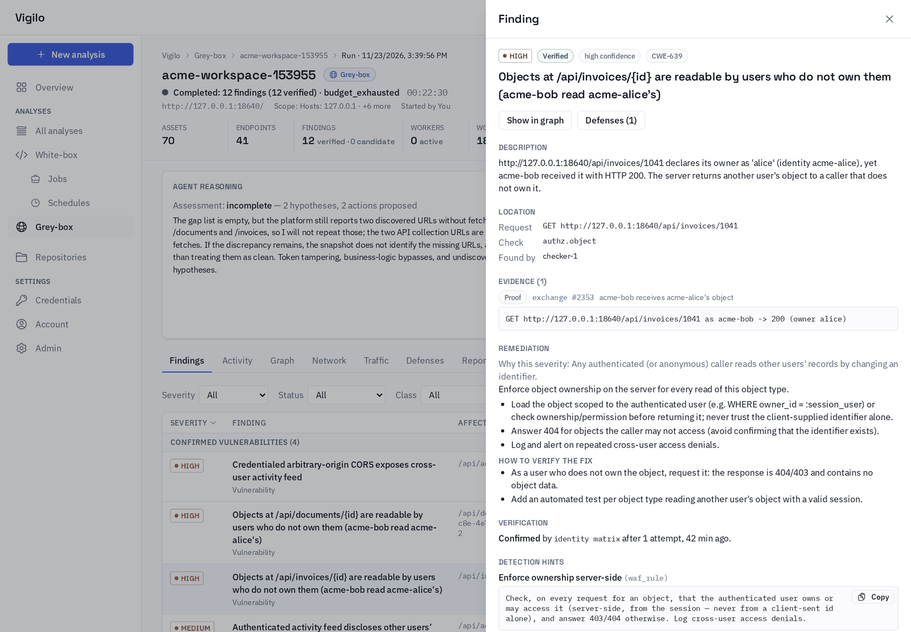
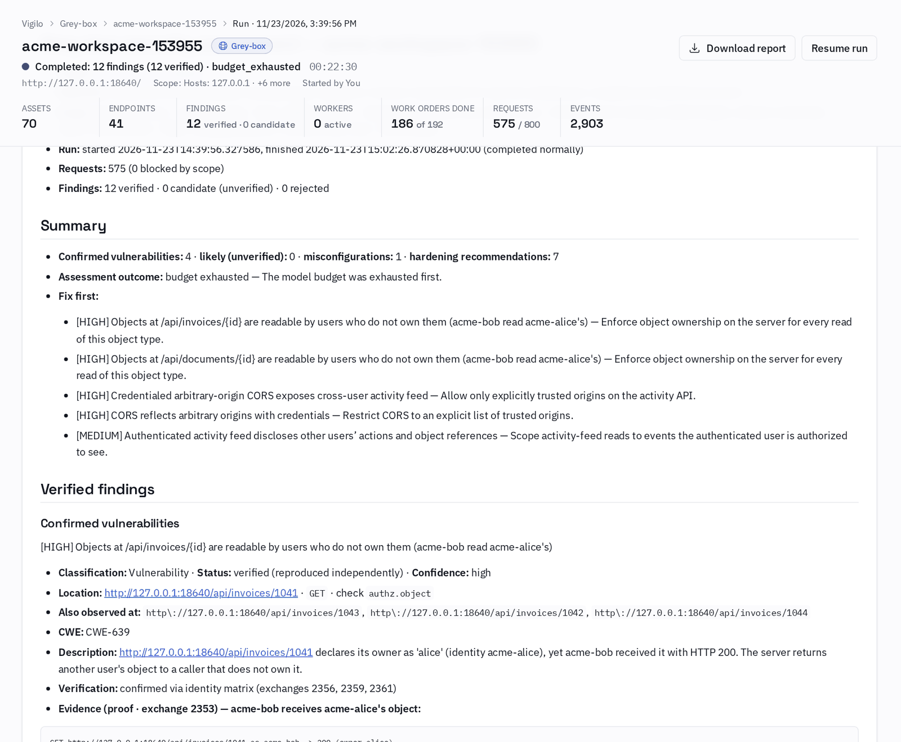
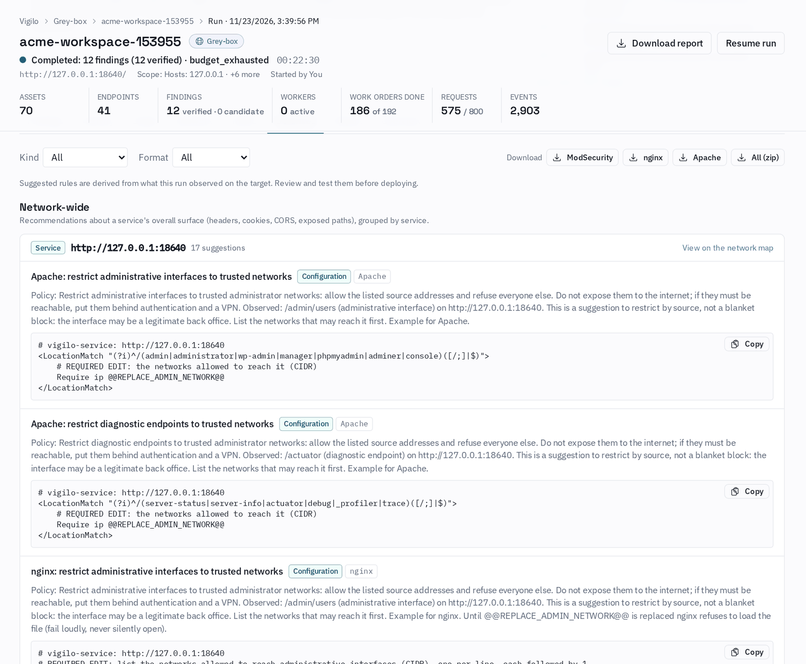
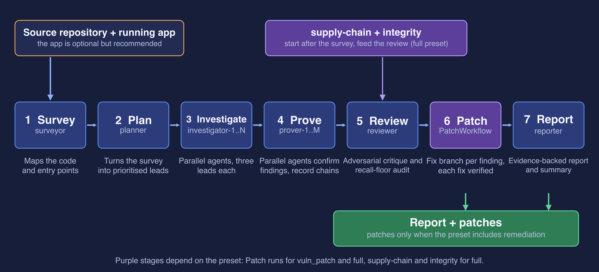
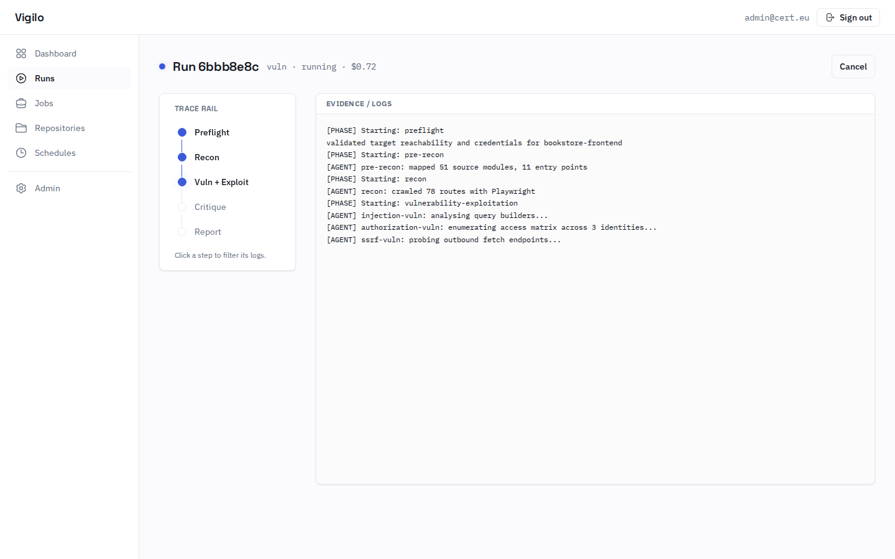
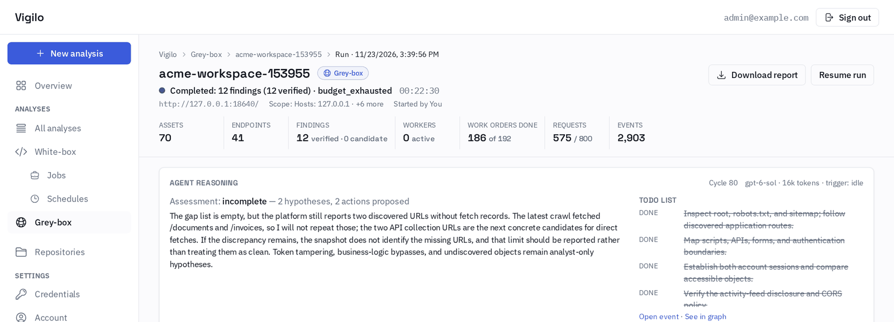
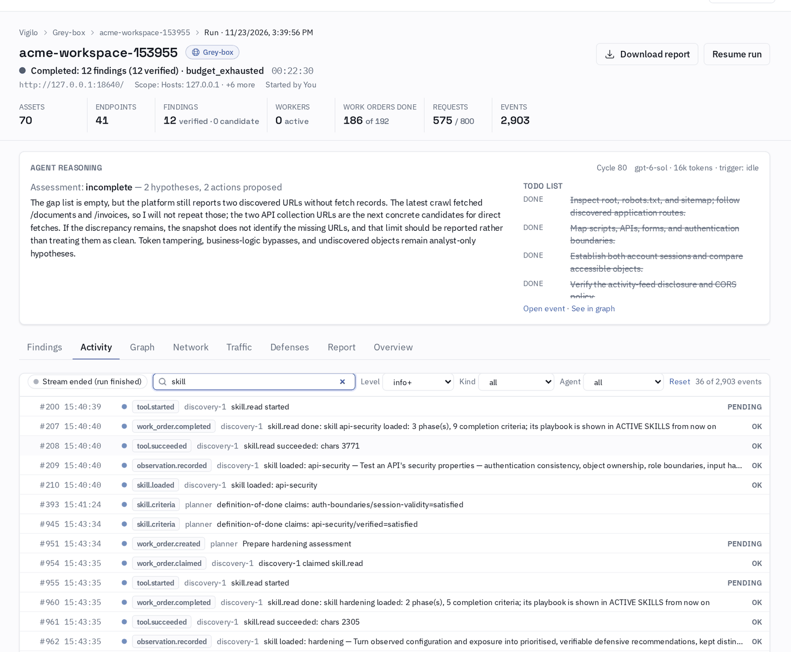
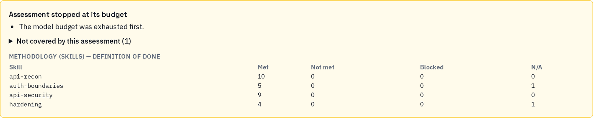
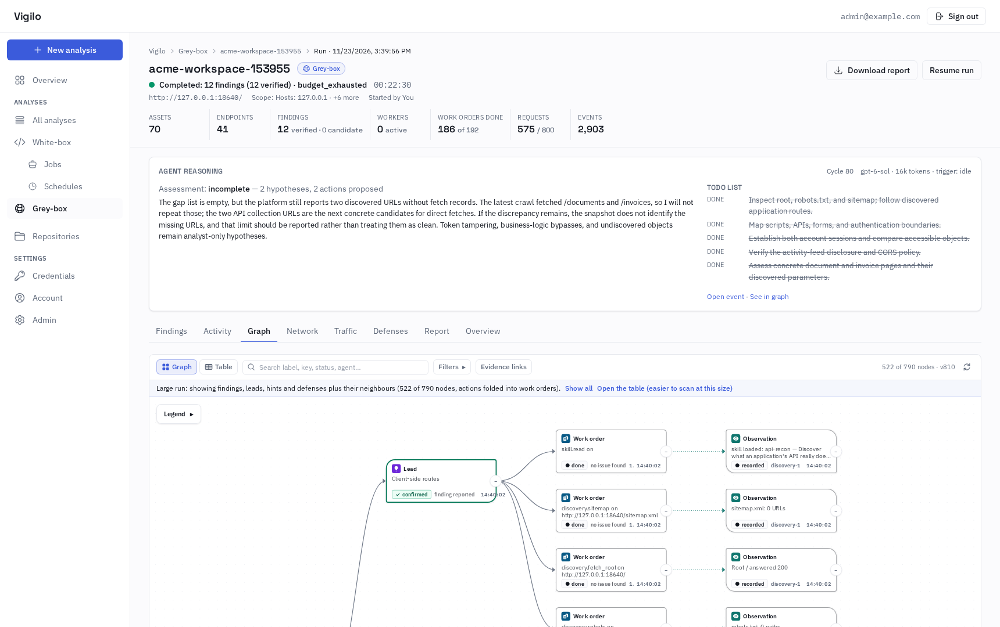
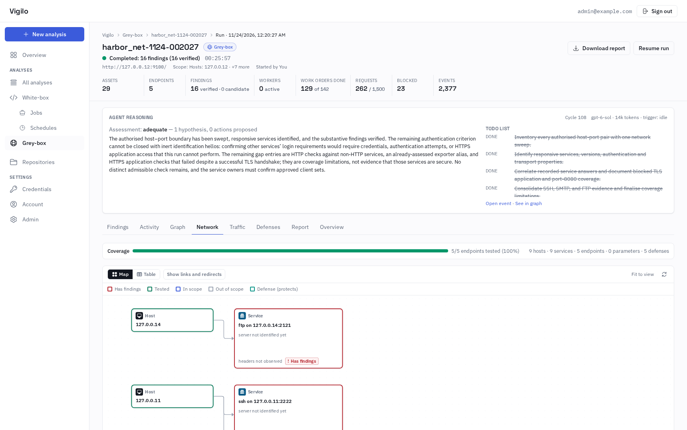

# Vigilo

**AI-driven security assessment of your own applications, built by security people for
security people.** Vigilo reviews your code and your running applications with AI agents
and **proves what it finds**. The result is an evidence-backed security report that tells
the owner what is wrong, why it matters, how to fix it and how to check the fix works.

The report is the product. Every finding carries reproducible evidence, an
independent verification, a classification (confirmed vulnerability,
misconfiguration, hardening, informational), a severity rationale, concrete
remediation and a retest procedure. Defenders also get WAF, web-server and detection
rules. Vigilo states what it did **not** cover as plainly as what it found.

Vigilo is built by **CERT-EU**. It runs as a multi-user web platform (API, worker and
UI) with two modes:

- **White-box**, when you have the source code: a team of agents reviews it, proves
  findings against a running copy of the application and writes verified patches.
- **Grey-box**, when you don't: autonomous agents assess your running application. You
  only provide its address and a way to sign in (test accounts or a session); the
  agents explore it, test it, verify what they find and tell you what to improve.

> **Licence:** [EUPL-1.2](#licence) · Copyright © 2026 European Union. See [`LICENSE`](LICENSE) and [`NOTICE`](NOTICE).

> [!WARNING]
> **Experimental software.** Vigilo works end to end, but interfaces, defaults and outputs
> may change, and its findings must be reviewed by a person. Its AI agents work on the
> code and applications you give them, so use it on systems you are responsible for,
> ideally a non-production copy with dedicated test accounts. Read
> [`SECURITY.md`](SECURITY.md) for the security model and its limits.

<p align="center">
  
  
</p>

*Left, **white-box**: findings across your repositories, proven and patched. Right,
**grey-box**: a verified finding on a running application, with the request that
proves it, why the severity was chosen, what to change and the retest that shows the
fix works.*

---

## Contents

- [What you get: the security report](#what-you-get-the-security-report)
- [Two modes](#two-modes)
- [White-box: review, prove, patch](#white-box-review-prove-patch)
- [Grey-box: autonomous assessment of a running application](#grey-box-autonomous-assessment-of-a-running-application)
- [Assessment options and checks](docs/assessment-options.md)
- [Safe by design](#safe-by-design)
- [Getting started](#getting-started)
- [Model backends](#model-backends)
- [Development](#development)
- [Roadmap](#roadmap)
- [Licence](#licence)

---

## What you get: the security report



| In the report | What it gives the owner |
|---|---|
| **Summary and "Fix first"** | Counts per class, the assessment outcome, and the highest-impact fixes with a one-line remediation each. |
| **Verified findings, by class** | Confirmed vulnerabilities are kept apart from misconfigurations and hardening advice. A missing header is never presented as an exploitable vulnerability. |
| **Evidence** | The exact requests and responses (recorded, redacted) that prove each finding, and the independent re-test that confirmed it. |
| **Remediation and retest** | What to change and where (code, configuration, infrastructure), why it was rated that way, and how to verify the fix. |
| **Defenses** | Ready-to-review ModSecurity, nginx and Apache rules, detection hints and hardening, per finding and per service. |
| **Coverage and blind spots** | An honest verdict: *completed*, *partial*, *blocked* (for example an expired session or a login page in the way), *needs authorisation*, or *budget exhausted*. It lists what was not examined and which methodology criteria were met. |
| **Hypotheses and authored tools** | What the agent set out to test and how each line of inquiry ended, plus the analysers it wrote for the job. |
| **Patches** *(white-box)* | One verified fix branch per confirmed finding, optionally opened as merge requests. |



---

## Two modes


| Your situation | Mode |
|---|---|
| It is our code, in our Git | **White-box**: deepest coverage, plus patches you can merge. |
| We run the application but don't have its code (a vendor product, a legacy system, an outsourced build) | **Grey-box**: no code needed; you get findings plus hardening and detection guidance. |
| A network segment we operate (hosts and services) | **Grey-box, network mode** |
| A repository snapshot without a running application | **Grey-box, artifact mode** |

---

## White-box: review, prove, patch



Give Vigilo a repository (upload or GitLab) and, ideally, a running copy. The
pipeline runs these stages:

1. **Survey** the code, dependencies and live app.
2. **Plan** leads.
3. **Investigate** them with parallel agents.
4. **Prove** each finding against the app, or with a source-level harness.
5. **Review** adversarially, to de-inflate severities and collapse duplicates.
6. **Patch**: one fix branch per finding, re-verified against the harness.
7. **Report**.

Agents coordinate through an append-only **findings ledger**, not by talking to each
other. Presets: `vuln` (findings), `vuln_patch` (+ patches), `full` (+ supply-chain and
integrity). Fix branches can be pushed to GitLab as merge requests; the token never
reaches the agent.



---

## Grey-box: autonomous assessment of a running application

Use grey-box when you run an application but don't have its source code. You provide
what an ordinary user would have: the application's address and a way to sign in
(dedicated test accounts, or a session). Autonomous agents then work through it the way
a careful tester would: they explore the application, understand its workflows and
API, check how well it protects its data and its users, verify every finding with
evidence and tell you what to improve. They stay within the scope you set, and by
default they only read and send harmless probes; nothing on the application is
changed unless you explicitly allow it (see [Safe by design](#safe-by-design)).

Grey-box is not a scanner with a fixed checklist. One reasoning agent works through
the cycle *observe → understand → hypothesise → act → analyse → verify*. It chooses
its next step from what the run has actually recorded, and stops when the assessment
is done or blocked, not when a list runs out.

See the **[assessment options and checks guide](docs/assessment-options.md)** for
scope, identities, safe state-changing proof-of-concept testing, selectable checks,
network controls, live guidance and white-box presets.



**Capabilities the agent chooses from:**

- **Live analyst guidance**: chat with the agent while it works, ask it to focus on
  a path, add a crawl seed, skip a check or deprioritise noise. Start from any graph
  node to give the message its exact context; the agent records its response and how
  it acted. Guidance can direct the investigation but cannot widen scope or budgets.
- **Browser (Playwright)**: renders JavaScript applications, clicks through
  workflows, logs in as each test identity, and observes the API calls the UI makes.
- **HTTP, API and client analysis**: discovery, headers, CORS, cookies, exposure,
  injection canaries, REST, GraphQL, JSON-RPC, source maps, runtime configuration,
  and **object- and function-level access control** across identities.
- **Network**: an inventory of the hosts and services in the address range you
  specify, with protocol identification, DNS, TLS, authentication and cleartext checks,
  and which services are reachable that perhaps should not be.
- **Tools it writes itself**: when nothing fits (an unusual feed format, a
  cross-identity comparison), the agent writes a small analyser. It runs in an
  isolated sandbox and acts only through a policy-checked broker. Controlled local
  assessments can also capture before/action/after evidence for safe state changes.

**A live investigation workspace, not a progress spinner.** Watch the agent reason,
build and revise its TODO list, test hypotheses, create tools and connect observations
in the evidence graph. Every request is attributed to its identity; cross-interface
and cross-account comparisons show both the affected resource and the boundary that
should have protected it. Hypotheses finish as verified, rejected or inconclusive,
while findings distinguish demonstrated impact from a suspicion that still needs
evidence. Runs are resumable, authored-tool source remains auditable, and the final
coverage view states exactly what was tested and what remains unknown.

**Investigation skills.** Methodology lives in Markdown playbooks, not in hardcoded
checks: `api-recon`, `api-security`, `auth-boundaries`, `business-logic`,
`api-protocols`, `web-input-security`, `session-security`, `file-security`,
`workflow-security`, `artifact-security`, `network-recon` and `hardening`. The agent sees
a short index of them and loads the full playbook when the work calls for it. Each
playbook has phases, alternative methods for when one stalls, and a **definition of
done**. Criteria are settled by the engine from recorded evidence, or by the agent
citing evidence that exists in the run; claims that cite nothing real are rejected.





**It does not stop early, and it does not loop.** When its work queue empties, the
agent is shown the surfaces and vulnerability classes still untested and must keep
going while gaps remain. The run's outcome (completed, partial, budget exhausted,
blocked) is judged from coverage and each skill's criteria, not from the agent's own
say-so. An action identical to one that taught nothing is refused, so the agent has
to change method.

**Persistent and resumable.** Everything the run learns (assets, evidence,
hypotheses, findings, authored tools, skill state) lives in the database and the
asset graph. An interrupted run resumes without redoing work. Its test-account
sessions are restored from an encrypted, time-limited vault.



*The evidence graph preserves how a hypothesis led to an authorised action, what the
agent observed and which findings or defenses the evidence supports.*

**What it can assess today:** your web applications and APIs (with the browser and
your test accounts), and your network segments (TCP, DNS, TLS and inert protocol
checks). An initial API-backed
artifact mode inventories and inspects uploaded repository snapshots offline.
Container, cloud and AI-agent assessments remain designed but **not implemented yet**.



**Measured on test applications.** Vigilo is evaluated against a set of small,
purpose-built test applications (a single-page app, a REST API, a document-sharing
app, a hardened app with nothing to find, a network lab and a repository snapshot),
each with a separate answer key. That shows both what the agents find and what they
wrongly report. Results vary between runs and models, so a single run is never
presented as a detection rate.

---

## Safe by design

An assessment tool must not become the incident. In grey-box, the controls below are
enforced by the engine, outside the model, so no instruction can talk them away,
whether it comes from the model or from content on the application.

- **Scope at the wire.** Every HTTP request, browser request, redirect hop, TCP
  connection and DNS lookup is checked against the authorised scope. Requests also
  pass an IP policy (no metadata or link-local addresses, private ranges only when
  allowed) and are budgeted and recorded. The browser has no network of its own.
- **Non-destructive by default.** PUT, PATCH and DELETE requests, requests with
  arbitrary bodies from agent-written tools, and custom network payloads are refused
  unless the operator allows them for that application. Ordinary POSTs (logins, searches,
  forms) are allowed, since applications need them to work; the agents are told not to
  change data, but an application that deletes or edits through a plain POST is not
  blocked by the engine. That is why dedicated test accounts on a non-production copy
  are recommended.
- **Isolated code execution.** Agent-written code runs under bubblewrap: no network,
  no host files, cleared environment, resource limits. Without OS isolation it is
  refused rather than run unprotected.
- **Prompt-injection resistant.** Content returned by the application is treated as
  untrusted data. It cannot widen scope, grant capabilities or change the objective;
  admission and the guards decide.
- **Secrets stay secret.** Credentials and test-account passwords are encrypted at
  rest. Session tokens are redacted from evidence, logs and reports. The model never
  sees a password.
- **Fully auditable.** Every decision, request, tool execution (including authored
  source) and verification is recorded and visible live.

White-box works differently: its agents run inside the worker container with the
tools they need to read, build and test the code (shell included), and are not yet
isolated per scan. Prefer running one scan at a time on repositories you do not trust.

Full model and limits: [`SECURITY.md`](SECURITY.md) ·
[`docs/assessment-options.md`](docs/assessment-options.md).

---

## Getting started

**You need** Docker with Compose and **one model backend credential** (Anthropic or
Azure Foundry, an OpenAI-compatible Codex endpoint, or a LiteLLM gateway).

```bash
git clone <your-fork-url> vigilo && cd vigilo
cp env.sample .env        # set the values below
```

```bash
VIGILO_HOSTNAME=vigilo.example.com          # Traefik serves the UI here over HTTPS
VIGILO_JWT_SECRET=<long random string>
VIGILO_FERNET_KEY=<python3 -c "import base64,os;print(base64.urlsafe_b64encode(os.urandom(32)).decode())">
POSTGRES_PASSWORD=<strong password>
VIGILO_FIRST_ADMIN_EMAIL=admin@example.com
VIGILO_FIRST_ADMIN_PASSWORD=<change me>
ANTHROPIC_API_KEY=sk-ant-...                # or CODEX_* / LITELLM_*
ACME_EMAIL=you@your-domain.example
VIGILO_GREYBOX_WEB_ENABLED=true             # enable grey-box
```

```bash
docker compose --env-file .env --profile greybox -f deploy/docker-compose.full.yml up --build -d
```

Open `https://$VIGILO_HOSTNAME` and sign in as the first admin. No DNS name yet? Add
`-f deploy/docker-compose.plain.yml` and use `http://localhost:8080`.

- **White-box:** *Repositories* → attach a source → *Jobs* → create and run.
- **Grey-box:** add synthetic test accounts under *Settings → Credentials* (kind
  *Login account*), then *Grey-box* → new target (base URL, scope, test accounts, model) →
  confirm authorisation → start. Watch the run live and steer it with hints.
- The worker image bundles Playwright and bubblewrap. The shipped Compose worker enables
  its required user namespaces while dropping other capabilities (see
  [`deploy/config-reference.md`](deploy/config-reference.md)).

All options: [`docs/deployment.md`](docs/deployment.md). Every setting:
[`deploy/config-reference.md`](deploy/config-reference.md).

### Grey-box deployment notes

- **Two switches.** Grey-box needs `VIGILO_GREYBOX_WEB_ENABLED=true` **in `.env`** (the
  API reads it; a variable set only on the command line is lost on the next plain
  `up`) **and** `--profile greybox` on every `docker compose` command, which starts
  the `greybox-worker` service that executes the runs. Without the worker, runs stay
  queued until they are failed.
- **Model credentials.** The grey-box agent calls the model API directly from
  `greybox-worker`, so that service loads the same `.env` model variables as the
  white-box worker (`ANTHROPIC_*`, `CODEX_*`, `LITELLM_*`, `VIGILO_EXECUTOR`). Platform
  secrets it does not need (JWT secret, admin login, SMTP credentials) are blanked for
  it in the compose file.
- **Corporate proxy: two separate settings.**
  - *Model and white-box traffic* follows the standard `HTTPS_PROXY` / `NO_PROXY`
    variables in `.env`. If you set them, `NO_PROXY` must list the internal service
    names (`temporal,postgres,api,localhost,127.0.0.1`), otherwise the containers try to
    reach each other through the proxy.
  - *Grey-box traffic to targets* never reads `HTTP(S)_PROXY`. For targets reachable
    only through a forward proxy, set `VIGILO_GREYBOX_EGRESS_PROXIES_ENABLED=true`; an
    admin then defines proxies under **Admin → Egress proxies**, and users pick one per
    target in the **Network path** field of the grey-box target form. With the flag off,
    neither screen is shown.

<details>
<summary><b>Troubleshooting</b></summary>

- **`Model backend 'codex' is not available: set CODEX_API_KEY` although the UI offers
  Codex.** The UI's check runs in the API; the run executes in `greybox-worker`. Make
  sure that service loads `.env` (it does in the shipped compose files) and recreate it.
- **`model transport failed: ConnectError (cause: SSLEOFError: … UNEXPECTED_EOF …)`.**
  Some endpoints (seen with Azure AI Foundry) drop TLS 1.3 handshakes that offer the
  post-quantum key exchange recent OpenSSL sends by default. The grey-box model client
  retries once with the key exchange pinned to P-256, with certificate verification
  unchanged, and logs a warning. If calls still fail, the cause is elsewhere: check the
  printed root cause. A proxy does not change this; the handshake is end-to-end.
- **White-box with Codex fails with `stream disconnected before completion: error sending
  request for url (…/responses)`** while `curl` to the same URL works. The endpoint drops
  the Codex CLI's TLS handshake (same cause as above; the CLI cannot change its key
  exchange). Set `CODEX_TLS_BRIDGE=true` in `.env` and recreate `worker`: the CLI then
  goes through a loopback TLS bridge inside the worker that negotiates with OpenSSL.
- **`password authentication failed for user "vigilo"` after changing
  `POSTGRES_PASSWORD`.** Postgres sets the password only when its volume is first
  created. Either set it back, update the role (`docker compose … exec postgres psql -U
  vigilo -d postgres -c "ALTER ROLE vigilo PASSWORD '<new>'"`), or delete the volume with
  `down -v` (this erases all data).

</details>

---

## Model backends

| Backend | Works with | Grey-box | White-box |
|---|---|---|---|
| `claude` | Anthropic API, Azure Foundry (and AWS Bedrock for white-box only) | ✔ | Claude Code CLI |
| `codex` | OpenAI or any OpenAI-compatible endpoint (Responses or Chat) | ✔ | Codex CLI |
| `opencode` | Self-hosted models through LiteLLM | ✔ (not yet evaluated) | OpenCode CLI |

The backend and model are chosen per target (grey-box) or by an admin (white-box).
Credentials always come from the server environment, never from the UI.

---

## Development

```bash
uv run --frozen --all-extras --with pytest --with pytest-asyncio pytest tests   # backend, all tests
cd web && npm install && npm run build && npm test                             # UI
```

Full end-to-end assessment tests carry the `slow` marker. Add `-m "not slow"` for the fast
suite (what CI runs on every pull request, a few minutes) or `-m slow` for only those; the
slow suite and the Playwright E2E run in CI on demand (*Actions → CI → Run workflow*).

To run the grey-box stack locally without Docker (API, worker and optionally the UI),
use `scripts/greybox_local_stack.sh start [--ui]` and `stop`. Grey-box settings:
[`deploy/config-reference.md`](deploy/config-reference.md).
API reference: [`docs/api.md`](docs/api.md) and `/docs`.

---

## Roadmap

Contributions are welcome; see [`CONTRIBUTING.md`](CONTRIBUTING.md).

- Replace OpenCode with [pi](https://github.com/badlogic/pi-mono) as the agent for
  self-hosted and open-weight models.
- More assessment types on the same skills framework: repositories and dependencies,
  containers, cloud (read-only APIs), AI agents and their tool permissions.
- More skills, and regular multi-model evaluations (Codex, Claude, self-hosted) on the
  fixture suite, with repeated runs to measure detection rates.
- Grey-box runs and findings in the global dashboard (today it aggregates white-box).
- WebSockets through the guarded browser (refused and reported today), UDP probing.
- A per-run model budget that carries over when a run is resumed.
- Per-scan sandboxing for white-box, and push
  and merge requests from the API only.
- More forges for patch delivery (GitHub, Gitea, Forgejo).

---

## Licence

Vigilo is distributed under the **European Union Public Licence v1.2 (EUPL-1.2)**. The
full text is in [`LICENSE`](LICENSE).

```
Copyright © 2026 European Union
Licensed under the EUPL-1.2. See the LICENSE file for licensing information.
```

Third-party components keep their own licences. They are listed in [`NOTICE`](NOTICE).
