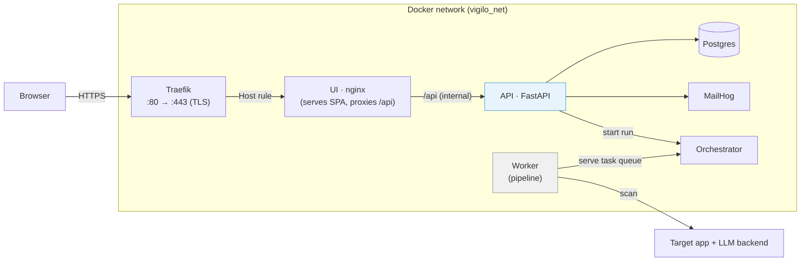

# Deployment and architecture

Reference material for running the Vigilo web platform. For the quick start, see the
[main README](../README.md#getting-started-web-platform). Every environment variable is
documented in [`deploy/config-reference.md`](../deploy/config-reference.md).

- [Architecture](#architecture)
- [Deployment options](#deployment-options)
- [Docker Compose files, explained](#docker-compose-files-explained)

---

## Architecture

The web platform is a set of containers that talk over a private Docker network. A job created
in the UI/API starts a real orchestrated workflow; a worker runs the pipeline against the repo on a
shared volume and writes the report and logs back.

| Component | What it is | Role |
|-----------|-----------|------|
| **UI** | React + Vite + TypeScript SPA (nginx) | The web app. Talks only to the API. |
| **API** | FastAPI (`src/webapi/`) | Auth, repositories, jobs, runs, reports, dashboards, scheduling, email. Starts pipeline runs. |
| **Worker** | Python orchestrator worker (built from the root `Dockerfile`) | Executes the white-box engine. Grey-box runs use the separate `greybox-worker` service (same image, `greybox` profile). |
| **Orchestrator** | Orchestrator server (`start-dev`) | Orchestrates the long-running pipeline workflow and its activities. |
| **Postgres** | PostgreSQL 16 | The platform's system of record (users, repos, jobs, runs, metrics). |
| **MailHog** | Mail catcher | Dev SMTP sink for invitation + report emails. Internal-only; swap for a real relay in production. |
| **Traefik** | TLS reverse proxy | The **only** service with published ports (`80` → redirects to `443`, `443`). Terminates TLS (certificates from Let's Encrypt, or any ACME CA you point it at) and routes the public hostname to the UI. Optional — see [Deployment options](#deployment-options). |



**Exposure:** only Traefik publishes host ports (`80`/`443`). The UI is the sole public
router (`https://$VIGILO_HOSTNAME`); the API, Postgres, Orchestrator and MailHog have **no
published port and no router** — they are reachable only on the internal `vigilo_net`
network. The browser never talks to the API directly: the UI's nginx proxies `/api` to it
internally. HTTP is redirected to HTTPS, and HSTS + anti-clickjacking/sniffing headers are
applied by Traefik. If you replace Traefik with your own reverse proxy, the internal layout
is unchanged — only the front door moves.

---

## Deployment options

By default Vigilo puts **Traefik** in front of the stack and gets a TLS certificate from
**Let's Encrypt**. That fits a server with a public DNS name, but it is not the only way to
run it. All the options below use the same `deploy/docker-compose.full.yml` — there is one
source of truth, and you change behaviour with environment variables or a small override
file, never by editing the compose file.

| Your situation | What to do |
|----------------|------------|
| Public server with a DNS name | Nothing extra. This is the default. |
| Your organisation runs its own ACME CA | Set `ACME_CASERVER` in `.env`. |
| You already run a reverse proxy or load balancer | Skip Traefik, publish the UI on a local port, terminate TLS in your proxy. |
| Trying Vigilo out, no hostname or certificate | Skip Traefik and use plain HTTP. |

### Option 1 — Traefik + Let's Encrypt (default)

```bash
docker compose --env-file .env -f deploy/docker-compose.full.yml up --build -d
```

Set two things in `.env`:

```bash
VIGILO_HOSTNAME=vigilo.example.com     # the public name of this host
ACME_EMAIL=you@your-domain.example     # a real address; Let's Encrypt rejects @example.com
```

Two things must be true before the first start, or certificate issuance fails:

- `VIGILO_HOSTNAME` resolves to this host.
- Let's Encrypt can reach this host on **port 80** — that is where the ACME HTTP-01
  challenge is answered. Open it in your firewall.

Certificates are stored in the `acme_data` Docker volume, so they are reused across
restarts and renewed automatically. Deleting that volume forces a fresh issuance.

### Option 2 — Traefik + your own ACME CA

If your organisation issues certificates from an internal ACME server, point Vigilo at it:

```bash
ACME_CASERVER=https://acme.your-internal-ca.example/acme/directory
```

Everything else is identical to option 1: the CA still has to reach this host on port 80
for the HTTP-01 challenge. Browsers on your network must already trust that CA's root
certificate — Vigilo does not distribute it.

### Option 3 — No Traefik (your own reverse proxy, or plain HTTP)

Layer the `plain` override on top of the full stack. It stops Traefik from starting and
publishes the UI's own nginx on a host port instead:

```bash
docker compose --env-file .env \
  -f deploy/docker-compose.full.yml \
  -f deploy/docker-compose.plain.yml \
  up --build -d
```

The UI is then at **`http://localhost:8080`**. Change the port with `VIGILO_HTTP_PORT`.
Nothing else changes: that nginx serves the web app and proxies `/api` to the API over the
internal network, exactly as it does behind Traefik.

**If you have your own reverse proxy** (nginx, HAProxy, Apache, a cloud load balancer),
point it at that port and terminate TLS there. Two extra steps:

```bash
VIGILO_HTTP_PORT=127.0.0.1:8080                # only reachable from this machine
VIGILO_UI_BASE_URL=https://vigilo.example.com  # the public URL, used in email links
```

Binding to `127.0.0.1` keeps the unencrypted port off the network when your proxy runs on
the same host. `VIGILO_UI_BASE_URL` matters because invitation and report emails would
otherwise link to the wrong address.

One thing you take over: the HTTP→HTTPS redirect and the security headers (HSTS,
`X-Content-Type-Options`, `X-Frame-Options: DENY`, `Referrer-Policy`) are applied by
Traefik in options 1 and 2. Without Traefik, configure them in your own proxy.

Already have certificate **files** rather than an ACME CA? Use this option and load them
into your own proxy — the bundled Traefik only knows how to fetch certificates over ACME.

> **Security note.** Without TLS, logins and reports travel in clear text. Plain HTTP is
> fine on `localhost` for a trial, and fine behind a proxy that terminates TLS. Do not
> publish port 8080 to an untrusted network.

### What is exposed, in every option

Only the front door changes. The API, Postgres, Orchestrator and MailHog never get a published
port or a public route in any of these setups — the browser always reaches the API through
the UI's internal `/api` proxy.

---

## Docker Compose files, explained

Vigilo runs on the web platform; every compose file lives in `deploy/`.

### The platform (`deploy/`) — API + web UI, multi-user

| File | For | When to use |
|------|-----|-------------|
| `deploy/docker-compose.full.yml` | **Full platform** — Traefik (TLS) + Postgres + API + UI + MailHog + Orchestrator + Worker | **The way to run white-box scans.** Serves the UI at `https://$VIGILO_HOSTNAME`; only Traefik publishes ports (80/443), everything else is internal. |
| `deploy/docker-compose.plain.yml` | *Override* for the full platform | Layer it on to run **without Traefik and without TLS**, publishing the UI on a host port. See [Option 3](#option-3--no-traefik-your-own-reverse-proxy-or-plain-http). |
| `deploy/docker-compose.api.yml` | **API only** (Postgres + API, no UI) | Headless / external API consumers, or when you only need the API surface. |

**Grey-box in the web platform (optional).** The platform can also run grey-box analyses from the UI
(flag `VIGILO_GREYBOX_WEB_ENABLED`, off by default). Its executor is a separate process: start the
`greybox-worker` service of the full or API compose file with `--profile greybox`
(`docker compose --env-file .env --profile greybox -f deploy/docker-compose.full.yml up -d`), scale it with
`--scale greybox-worker=N`, and keep `VIGILO_GREYBOX_ALLOW_PRIVATE_TARGETS=false` in production. Every setting is
in [`deploy/config-reference.md`](../deploy/config-reference.md#grey-box-web-platform).

The `plain` override file is never used alone — it is layered onto a base file with a second
`-f`, e.g. `docker compose -f deploy/docker-compose.full.yml -f deploy/docker-compose.plain.yml up`.

> **Don't run two copies of the platform on one host.** `deploy/docker-compose.full.yml`
> attaches to a fixed Docker network called `vigilo_net`, so a second copy started under a
> different Compose project name joins the *same* network. Service names like `api` and
> `postgres` then resolve to either stack at random, which produces baffling intermittent
> failures.
